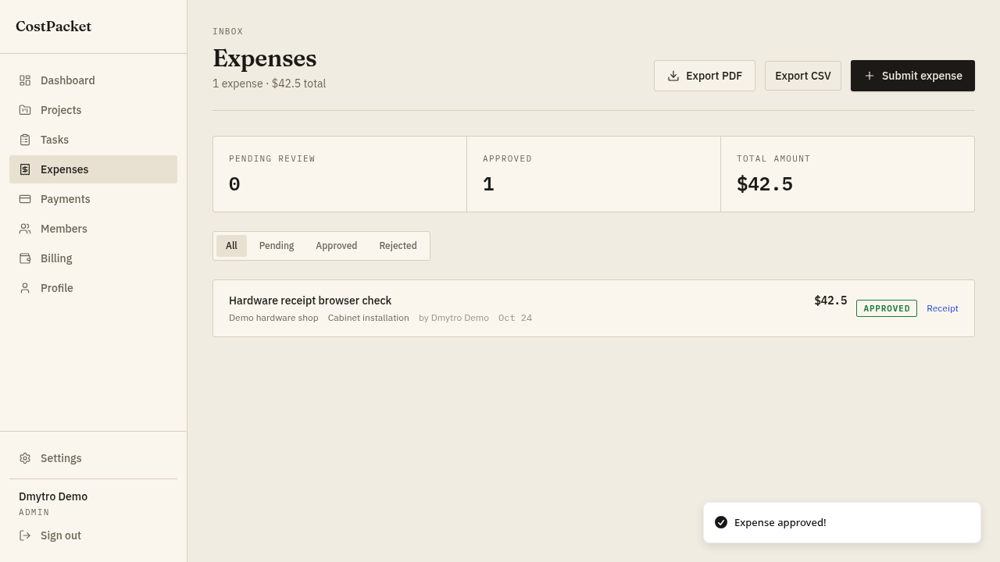

# CostPacket

[Open the application](https://costpacket.yshxsp.workers.dev)

Expense approvals and job costing for small contractors. Projects hold tasks,
receipts and expense records; staff review expenses and record manual payouts.
CSV and PDF exports provide a copy of the visible records.

This is a development project by Dmytro Filonenko. Screenshots and automated
browser checks use synthetic demonstration data, not customer results.



## Accessibility example

A [public walkthrough](https://costpacket.yshxsp.workers.dev/work/accessibility)
lets you try the corrected form and inspect the code without signing in.
A [controlled before/after demonstration](docs/accessibility-demo/README.md) includes
source, browser evidence and an HTML/PDF report. It is a personal demonstration.

## Current stack

- Next.js 16 and React, deployed to Cloudflare Workers through OpenNext.
- Neon PostgreSQL and Drizzle, in the isolated `costpacket` schema.
- Better Auth for email/password sign-in, verification and sessions.
- Private R2 receipt storage, accessed through authorized application routes.
- Resend for transactional email when configured.
- Optional Gemini receipt extraction; manual expense entry works independently.
- Optional Paddle subscription checkout. Payout records never transfer funds.

Supabase is no longer a runtime dependency. Historical Supabase migrations and
tests are retained only as reference in `docs/legacy-supabase/`.

## Local development

Use Node.js 24 and a Neon development branch or a local PostgreSQL instance.

```sh
npm ci --ignore-scripts
cp .env.example .env.local
# Set DATABASE_URL, BETTER_AUTH_URL and a random BETTER_AUTH_SECRET.
# Use MIGRATION_DATABASE_URL for a schema-owner connection if the runtime role is restricted.
npm run db:migrate
npm run dev:local
```

The local server runs at `http://127.0.0.1:3187`. Keep `COSTPACKET_LOCAL=1` for
Node development. Use a separate database/branch for tests and demonstrations.
Production receives Cloudflare bindings and does not use the local file-storage
fallback or email outbox.

To generate a local secret without changing existing database configuration,
`npm run setup:local` creates a starter `.env.local` if one is absent. Replace
its database URL before starting the app. Existing configuration is preserved.

For local email verification checks, set `DEV_EMAIL_OUTBOX` to a private local
file. Verification and invitation emails are captured there instead of being
sent. This option is restricted to local mode.

## Checks

```sh
npm run lint -- --max-warnings=0
npm test
npm run build:worker
npm audit --audit-level=high
```

`npm test` covers signature verification, CSV and file handling, untrusted
extraction output, bounded webhook bodies, and PostgreSQL access-control scenarios
in PGlite. It does not need hosted service credentials.

With the isolated local app running against Neon, `npm run test:auth` checks
sign-up, verification through the local outbox, five concurrent authenticated
requests and tenant-isolated export. This creates synthetic test accounts.

`tests/browser-smoke.js` is a Playwright CLI `run-code` scenario for the local
app: sign-up, project/task creation, receipt upload, manual expense approval,
CSV/PDF export, manual payout recording and profile updates. It assumes receipt
extraction is disabled and saves artifacts under `output/playwright/`.

## Cloud deployment

See [deployment and migration notes](docs/NEON-MIGRATION.md) for bindings,
credentials, verification evidence and service limits.

- Apply SQL migrations with the schema-owner connection. Migrations do not run
  inside the Worker.
- Give the runtime role access only to CostPacket tables, excluding `_migrations`.
- Set the Hyperdrive binding and disable its query cache for session and
  subscription freshness.
- Bind the private `costpacket-receipts` R2 bucket as `RECEIPTS`.
- Set `BETTER_AUTH_URL` to the deployed HTTPS origin and configure Worker secrets.
- Leave `COSTPACKET_LOCAL` and `DEV_EMAIL_OUTBOX` unset in production.

Optional extraction needs a working Gemini key. Optional billing needs the
CostPacket Paddle catalog, API key, webhook secret, public client token and price
ID. Browser checkout success does not grant subscription access.

Deployments are manually triggered; a source push does not automatically publish
the application.

## Boundaries

Each company has a separate authorization scope. Subcontractors see their
assigned tasks and own expenses/payouts. Staff manage work in their company;
only admins manage subscriptions, invite admins and confirm manual payouts.
Invitation acceptance requires a verified email and cannot silently discard an
existing workspace containing data or members.

Lists show at most 500 entries. CSV export uses bounded keyset pages, up to
10,000 records; PDF exports the displayed expense list. Receipt uploads accept
JPEG, PNG and WebP with size and hourly quota checks. Images remain private.

Deleting a project removes its linked tasks, expenses and payout records.
Receipt files have separate retention; automatic orphan-file deletion and
self-service account removal are not implemented.
