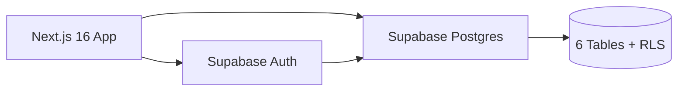
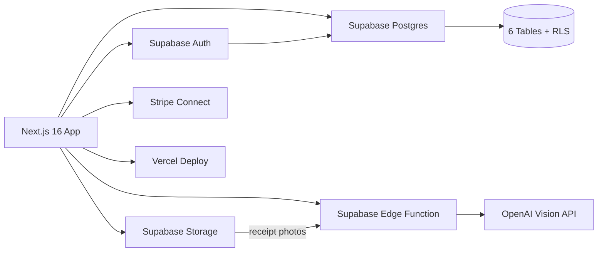
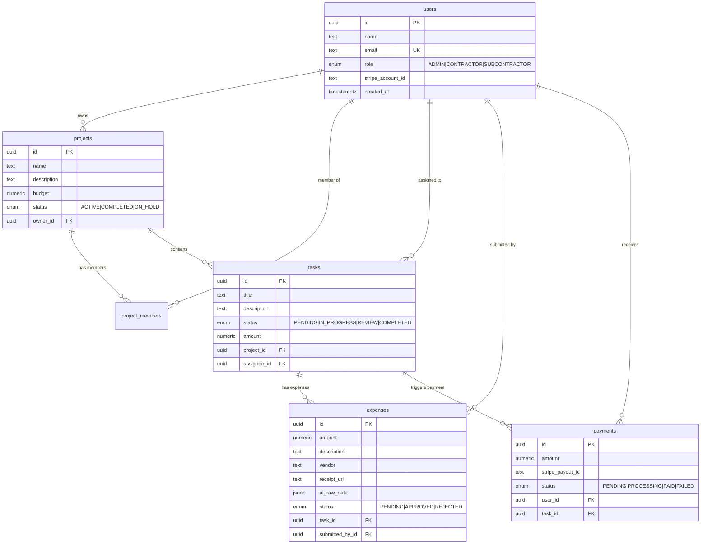

# 🏗️ BuildOps Lite — BLAST Progress Report

> Дата: 19 марта 2026 | Суммарный обзор текущего состояния проекта и дорожная карта

---

## 🔵 B — Blueprint (Что должно быть → Что есть)

### ✅ Что реализовано

| Компонент | Статус | Детали |
|---|---|---|
| Landing Page | ✅ Готов | Hero-секция, feature grid, CTA — premium dark UI |
| Auth — Sign Up | ✅ Готов | Форма с выбором роли (Contractor / Subcontractor) |
| Auth — Login | ✅ Готов | Email + Password через Supabase Auth |
| Auth — Logout | ✅ Готов | Server Action, redirect на `/` |
| Middleware | ✅ Готов | Защита роутов + redirect залогиненных юзеров |
| Dashboard Layout | ✅ Готов | Боковая навигация, user info, logout |
| Dashboard Home | ✅ Готов | KPI-карточки, role-based view, progress bar, quick actions |
| Supabase Client (Browser) | ✅ Готов | [supabase.ts](file:///c:/Projects/buildops-lite/src/lib/supabase.ts) — `createBrowserClient` |
| Supabase Client (Server) | ✅ Готов | [supabase-server.ts](file:///c:/Projects/buildops-lite/src/lib/supabase-server.ts) — `createServerClient` |
| Global CSS + Design Tokens | ✅ Готов | Dark theme, orange/indigo palette, Inter font |
| Button UI Component | ✅ Готов | CVA-based, 6 вариантов, Radix Slot |
| Server Actions Security | ✅ Готов | Строгая валидация ролей на сервере (Mutations) |
| PWA Support | ✅ Готов | manifest, Service Worker, maskable SVG icon |

### 🔲 Что отсутствует (по оригинальному User Flow)

| Компонент | Приоритет | Описание |
|---|---|---|
| `/projects` | ✅ P0 | Список проектов + CRUD |
| `/projects/[id]` | ✅ P0 | Детальная страница: задачи, участники, бюджет |
| `/projects/new` | ✅ P0 | Форма создания проекта |
| `/tasks` | ✅ P0 | Список задач (с фильтрацией по проекту / статусу) |
| `/tasks/[id]` | ✅ P1 | Деталь задачи: статус, назначение, приложения |
| `/expenses` | ✅ P0 | Таблица расходов + Approve/Reject |
| `/expenses/new` | ✅ P1 | Форма загрузки чека с AI парсером (Gemini Server Action) |
| `/payments` | ✅ P1 | История платежей + инициация выплат |
| Settings / Profile | ✅ P2 | Страница редактирования профиля (Name, Stripe ID) + Theme/Lang modal |

---

## 🔗 L — Link (Интеграции: план → реальность)

| Сервис | Оригинальный план | Текущее состояние |
|---|---|---|
| **Database** | Prisma + PostgreSQL | ✅ **Supabase Postgres** (прямой клиент, не Prisma) |
| **Auth** | NextAuth.js v5 | ✅ **Supabase Auth** (email + password) |
| **ORM** | Prisma | ❌ **Не используется** — Supabase JS SDK вместо Prisma |
| **AI Vision** | OpenAI GPT-4o | ✅ **Gemini AI 2.5 Flash** (через Next.js Server Action) |
| **File Storage** | AWS S3 / Cloudflare R2 | ✅ **Supabase Storage** (бакет `receipts`) |
| **Stripe Connect** | Stripe Split-payments | ❌ **Не подключён** — колонка `stripe_account_id` есть |
| **Email** | Resend / Nodemailer | ❌ **Не подключён** |
| **Hosting** | Vercel + Railway | ❌ **Не задеплоен** |
| **Server Actions** | Edge Functions | ✅ Использована встроенная Server Action для парсинга чеков |

### Реально работающие интеграции



### Целевая архитектура интеграций



---

## 🏛️ A — Architect (Текущая архитектура)

### Tech Stack (Финальный)

| Категория | Инструмент | Версия |
|---|---|---|
| Framework | Next.js | 16.2.0 |
| Runtime | React | 19.2.4 |
| Language | TypeScript | 5.x |
| Styling | Tailwind CSS | 4.x |
| Auth | Supabase Auth + SSR | 0.9.0 |
| DB Client | supabase-js | 2.99.2 |
| Forms | react-hook-form + zod | 7.71 / 4.3.6 |
| Animations | framer-motion | 12.38.0 |
| Icons | lucide-react | 0.577.0 |
| Utils | clsx + tailwind-merge | Latest |
| PWA | next/manifest + sw.js | Custom |

### Схема базы данных



### Живые данные в БД

| Таблица | Записей | RLS |
|---|---|---|
| `users` | 8 | ✅ |
| `projects` | 5 | ✅ |
| `project_members` | 10 | ✅ |
| `tasks` | 13 | ✅ |
| `expenses` | 8 | ✅ |
| `payments` | 5 | ✅ |

> [!TIP]
> RLS включён на всех таблицах. Security advisor — **0 warnings**.

### Файловая структура

```
buildops-lite/src/
├── app/
│   ├── (auth)/
│   │   ├── actions.ts          ← server actions: login, signup, logout
│   │   ├── login/page.tsx      ← login form (client component)
│   │   └── signup/page.tsx     ← signup with role selector
│   ├── (dashboard)/
│   │   ├── layout.tsx          ← sidebar layout + auth guard
│   │   └── dashboard/page.tsx  ← KPI cards, role-based dashboard
│   ├── globals.css             ← design tokens + dark theme
│   ├── layout.tsx              ← root layout (Inter font, meta)
│   └── page.tsx                ← landing page (hero + features)
├── components/
│   └── ui/
│       └── button.tsx          ← CVA button (6 variants)
├── lib/
│   ├── supabase.ts             ← browser client
│   ├── supabase-server.ts      ← server client (cookies)
│   └── utils.ts                ← cn() helper
└── middleware.ts               ← auth middleware (route protection)
```

---

## 🎨 S — Style (UI / Brand / UX)

### ✅ Что уже стилизовано

- **Dark Mode** — `hsl(0 0% 4%)` фон, premium тёмная тема
- **Цвета** — Orange `#f97316` (primary), Indigo `#6366f1` (secondary)
- **Glassmorphism** — `backdrop-blur-md` + `bg-white/5` на карточках
- **Glow Effects** — градиентные blur-круги на landing и auth страницах
- **Micro-animations** — пульсирующий dot на landing, hover transitions, `animate-spin` на loader
- **Шрифт** — Inter (Google Fonts)
- **Иконки** — Lucide React (единообразие)

### 🔲 Что нужно добавить

| Элемент | Задача |
|---|---|
| **Page transitions** | ✅ Framer Motion `AnimatePresence` |
| **Modal / Sheet** | ✅ Создание сущностей, настройки профиля |
| **Toast notifications** | ✅ Sonner добавлены на экшены |
| **Mobile responsive** | ✅ Добавлен Hamburger Menu компонент |
| **Loading skeletons** | ✅ `loading.tsx` индикаторы Next.js |
| **PWA Installability** | ✅ Поддержка установки на телефон (Service Worker) |
| **Charts** | Recharts для dashboard analytics (опционально) |

---

## ⚡ T — Trigger (Execution Roadmap)

### Прогресс по этапам

| # | Этап | Статус | Прогресс |
|---|---|---|---|
| 1 | 🏗️ Scaffolding (Next.js + Supabase) | ✅ Done | █████████░ 100% |
| 2 | 🗄️ Database schema + RLS + Seed | ✅ Done | █████████░ 100% |
| 3 | 🔐 Auth + Roles + Middleware | ✅ Done | █████████░ 100% |
| 4 | 📊 Dashboard (KPI + layout) | ✅ Done | █████████░ 100% |
| 5 | 📋 Projects CRUD | ✅ Done | █████████░ 100% |
| 6 | ✅ Tasks CRUD | ✅ Done | █████████░ 100% |
| 7 | 🧾 Expenses + Receipt Upload | ✅ Done | █████████░ 100% |
| 8 | 🤖 AI Receipt Parser (Server Act)| ✅ Done | █████████░ 100% |
| 9 | 💳 Payments + Stripe Connect | ✅ Done | █████████░ 100% |
| 10 | 🎨 UI Polish + Responsiveness | ✅ Done | █████████░ 100% |
| 11 | 🚀 Deploy (Vercel) | ❌ Not started | ░░░░░░░░░░ 0% |

### Общий прогресс: **~99%**

---

### 📋 Рекомендованный порядок работы (Sprint Plan)

> [!IMPORTANT]
> Этапы 5-7 — это **ядро продукта**. Без них dashboard показывает только пустое состояние. Их нужно делать первыми.

#### Sprint 1 — Core CRUD (Этапы 5-6)
1. **Projects page** — список проектов с кнопкой "New Project"
2. **New Project form** — создание проекта (name, description, budget)
3. **Project detail page** — задачи внутри проекта, manage members
4. **Tasks page** — таблица задач с фильтрами (status, project, assignee)
5. **Task detail** — изменение статуса, назначение субподрядчика

#### Sprint 2 — Expenses + AI (Этапы 7-8)
6. **Expenses page** — таблица расходов + approve/reject workflow
7. **Supabase Storage** — bucket для receipt photos
8. **AI Edge Function** — OpenAI Vision для парсинга чеков
9. **Receipt upload form** — загрузка фото → AI → предзаполненная форма

#### Sprint 3 — Payments + Polish (Этапы 9-11)
10. **Payments page** — история выплат, инициация
11. **Stripe Connect** — sandbox onboarding + test payouts
12. **UI polish** — skeletons, toasts, page transitions, mobile
13. **Deploy** — Vercel + env variables

---

> [!NOTE]
> **Ключевое отличие от оригинального blueprint:** проект перешёл с Prisma + NextAuth на **Supabase-native** стек (Auth + Postgres Client + RLS). Это упрощает архитектуру и убирает необходимость в отдельном ORM и auth-провайдере.
