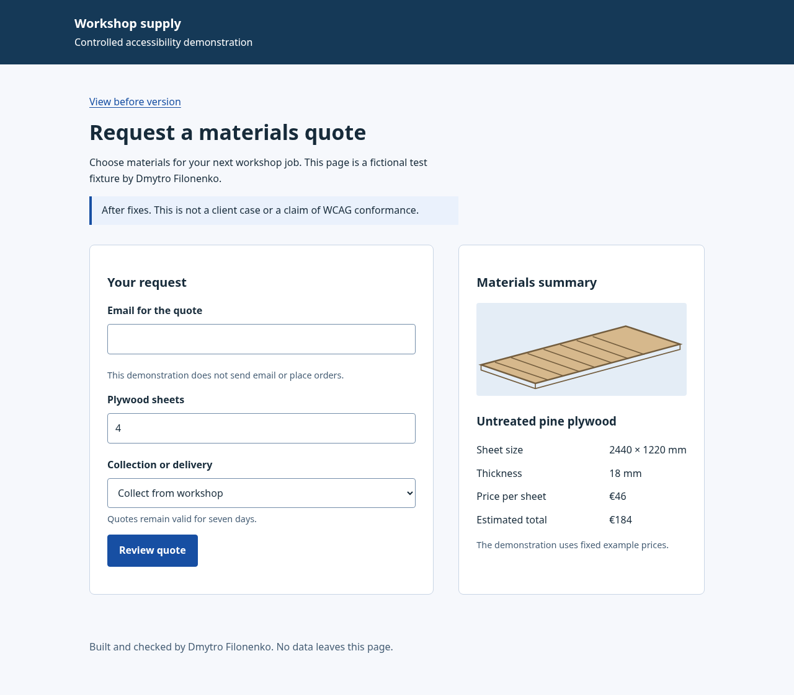

# Controlled accessibility demonstration

Built and checked by Dmytro Filonenko on 24 October 2026. This fictional quote
form is a personal demonstration, not a client case or a conformance assessment.

Open [the before fixture](before.html), [the after fixture](after.html), or the
[HTML report](report-after.html). A [PDF copy](report-after.pdf) is included.
Serve this directory locally, for example with `python3 -m http.server 3191`,
then visit `http://127.0.0.1:3191/after.html`. No email/order is sent by the fixture.

The tested axe-core tag set covered WCAG A/AA rules identified by `wcag2a`,
`wcag2aa`, `wcag21a`, `wcag21aa`, `wcag22aa`. Before: four failing rule groups
(color contrast, image alternatives, input labels, select naming). After and
open dialog: zero violations in that specific run. See [raw results](results.json)
and [static-engine findings](static-results.json). The two engines have different
coverage; static HTML cannot verify contrast, focus or scripted interactions.

Keyboard checks covered form reachability/order, invalid-email focus, dialog
containment, Escape/return focus and confirmation. A 320px layout and 200% text
resize at that width were checked. Speech output and screen-reader interaction,
other browsers and all WCAG criteria were not tested. Text resizing is not the
same as a real browser zoom/assistive-technology test.

The report was generated with Gangway's report generator using these actual
results. It records each automated finding as fixed after the tested rescan;
it does not infer full success-criterion conformance. No prospect site was altered.

